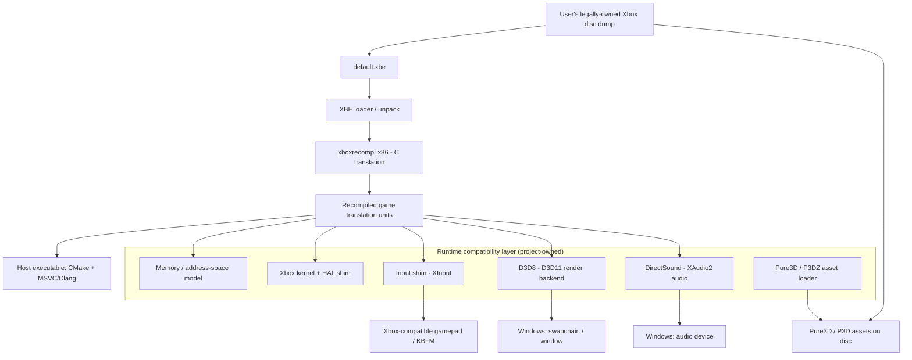

# Proposed Architecture — Road Rage Native PC Recompilation

Target: **original Xbox** release of *The Simpsons: Road Rage* (2001).
Host: **Windows x86-64**.
Strategy: **static recompilation** (x86 → C → native x86-64), not emulation, not a remake.

> Status: **proposed**. Nothing here has been built. Component claims reference the upstream
> repos listed in `UPSTREAM.md`; items marked *[unverified]* require confirmation against
> those sources before implementation (see `FEASIBILITY.md` §10).

> **M1 update (verified).** The Xbox executable has now been analysed and recompiled
> (see `docs/M1-RESULTS.md`). The engine is a **direct-XDK Direct3D 8** build —
> `tools.func_id` found **0 RenderWare identifiers**, and the XBE links
> `XAPILIB/D3D8/XBOXKRNL/CRT/XGRAPHC` with `D3D`, `DSOUND`, `BINK*`, `XGRPH`, `XPP`,
> `DOLBY` sections. Therefore the **RenderWare FLIRT / RW-bridge described below is
> refuted**.
>
> **M2 correction (verified).** The engine **is Pure3D** after all. In-binary strings
> include `NewRenderContext() failed`, `Cannot initialize PDDI library, unknown error.`
> and `Cannot initialize PDDI library due to an incorrect version` — **PDDI is Pure3D's
> Device Driver Interface**. So: RenderWare out, **Pure3D/PDDI in** (see
> `docs/M2-RESULTS.md` §8). The Pure3D/P3DZ asset path below is still provisional — the
> disc was not inspected in M1 or M2.

---

## 1. Design principles

1. **Faithful translation first, fidelity of behavior over cleverness.** The recompiled game
   code should be a mechanical translation so that physics, missions, AI and gameplay are
   preserved by construction.
2. **Bring your own disc.** The runtime never contains copyrighted assets; it reads a dump
   the user legally owns.
3. **No emulation, no interpreter.** Recompiled code runs natively. A small compatibility
   layer provides only what the platform *provided*, not a CPU interpreter.
4. **Prove the pipeline before building breadth.** Boot → render → assets → menu before any
   feature work.
5. **License hygiene.** Only license-compatible code may become a dependency; unlicensed
   repos are read-only references.

---

## 2. High-level pipeline



---

## 3. Components

### 3.1 XBE loader / unpacker *(project-owned)*

- Parse the XBE header: entry point, section table, base address, TLS if any.
- Locate and read the `.text` and data sections.
- Handle any image compression/encryption on the executable.
- Output: a laid-out image + metadata (entry point, section ranges) consumed by the
  translator and the runtime memory model.

### 3.2 Static recompiler — `xboxrecomp` *(reused, MIT)*

- Translates x86 (XBE) machine code into host C/C++.
- Responsibilities it is expected to cover: disassembly, function discovery, control-flow
  recovery, and code emission.
- **Verified in M0** (see `M0-RESULTS.md`): output is **C**; the toolkit **does ship a
  full runtime** (eight libraries — so §3.3–§3.5 are largely *reused, not written*); it
  builds with MSVC **or** a free Clang/Zig toolchain; indirect calls resolve through a
  generated flat dispatch table with a binary-search fallback. The earlier "assume **no**
  runtime, as with XenonRecomp" note was wrong.
- Fallback if it cannot resolve all control flow: manual annotation driven by **Ghidra**
  and **RenderWare FLIRT** signatures for symbol recovery.

### 3.3 Runtime compatibility layer *(provided by xboxrecomp; project work is per-title only)*

> **M0 correction:** `xboxrecomp` ships this layer as `xbox_kernel` (170 of 371 kernel
> ordinals with dedicated Win32 bridges; all 371 routed) plus `platform`. Our project
> implements only the per-title *gaps* the toolkit reports, not the layer itself.
> See `M0-RESULTS.md` §7–§8.

- **Memory / address-space model.** Preserve Xbox address-space expectations so absolute
  addresses and pointer arithmetic in the recompiled code behave. Options range from a
  32-bit shadow space to host mappings with a compatibility translation layer.
- **Kernel + HAL shim.** Implement only what the game imports and calls: file I/O, memory
  allocation (contiguous/virtual), thread/sync primitives, timing/performance counters,
  debug output. Reference: `xita` (GPL-3.0, archived) — **a reference, not a dependency**
  unless its license (GPL-3.0) is acceptable for the project.
- **Input shim.** Map Xbox controller state to XInput (and optional keyboard/mouse),
  preserving deadzone/trigger semantics.

### 3.4 Rendering backend — D3D8 → D3D11 *(implemented by `xbox_d3d8`)*

> **M0 correction:** the D3D8→D3D11 backend already exists in the toolkit
> (`src/d3d`), and its smoke tests were built and **passed** here (§`M0-RESULTS.md` §4.3).
> What remains ours is measuring Road Rage's actual D3D8 surface and filling gaps.

- The game calls **Direct3D 8**. Provide a D3D8-compatible surface that maps onto D3D11.
- **First measure the actual D3D8 surface used** before choosing scope: fixed-function T&L
  vs. vertex/pixel shaders, render targets, state blocks, texture formats.
- Reference implementations exist (`xboxdashboard` D3D8→D3D11; `mm3-recomp` D3D11 renderer)
  but **appear unlicensed** — treat as reference unless permission is obtained.
- Risk: if the game uses custom shaders (RW has a shader system), those need translation.

### 3.5 Audio — DirectSound → software mixer *(implemented by `xbox_dsound`)*

> **M0 correction:** the toolkit ships `xbox_dsound` (DirectSound8 → software mixer) plus
> `xbox_apu` (MCPX APU). We measure the game's actual surface and fill gaps rather than
> implementing the layer from scratch.

### 3.6 Asset loading — Pure3D / P3DZ *(project-owned; reference `BaseCrunch/Road-Rage-P3DZ-Decompressor`, MIT)*

- Read Pure3D/P3D files from the disc dump, including **P3DZ-compressed** files.
- The decompressor provides CLI + drag-and-drop Windows support, format documentation,
  validation, and tests — a strong starting point for the chunk reader.
- Feed decoded chunks to the recompiled RenderWare/Pure3D engine; the goal is to avoid
  reimplementing the entire RenderWare runtime, only what the game actually reaches.

### 3.7 Host / build system *(project-owned)*

- **CMake**-based build producing a Windows executable.
- Generated translation units from `xboxrecomp` + hand-written compatibility layer.
- Toolchain: MSVC (primary on Windows) or Clang (matching `xboxrecomp`'s requirements —
  *[unverified]*, confirm from its README).

---

## 4. Proposed repository layout

```
simpsons-recomp/
  CMakeLists.txt
  docs/                     # this research output
  tools/
    xboxrecomp/             # submodule/pinned copy of the MIT recompiler (or vendored)
  src/
    xbe/                    # XBE loader/unpacker
    runtime/                # memory model, kernel/HAL shim, input
    render/                 # D3D8->D3D11 backend
    audio/                  # DirectSound->XAudio2
    assets/                 # Pure3D / P3DZ loader
    host/                   # WinMain, window, main loop, CLI
  generated/                # recompiler output (not committed - regenerate locally)
  external/                 # third-party deps (license-checked)
```

Notes:
- `generated/` is **regenerated locally** from the user's own `default.xbe`; it is not
  committed (it derives from copyrighted code and would be a legal problem to redistribute).
- Any vendored upstream is pinned to a specific commit and its license recorded in
  `UPSTREAM.md`.

---

## 5. Asset / legal boundary in the architecture

The architecture **enforces** the bring-your-own-disc rule:

- No asset or executable bytes are shipped in the repo.
- The runtime takes a path to a user-supplied disc dump / `default.xbe`.
- Generated recompiled C derived from the game binary is treated as user-local build output
  and **not committed**.
- Precedent: this mirrors how existing recomp projects handle copyrighted inputs.

---

## 6. Milestone-to-architecture mapping

| Milestone (see ROADMAP.md) | Components touched |
|---|---|
| M0 — toolchain validation | §3.2 (`xboxrecomp`), §3.7 |
| M1 — XBE load + boot to logged halt | §3.1, §3.2, §3.3 (memory, minimal kernel) |
| M2 — kernel/HAL coverage | §3.3 |
| M3 — D3D8 device + clear screen | §3.4 |
| M4 — first Pure3D asset load | §3.6 |
| M5 — main menu | §3.3–§3.6 |
| M6 — in-game | all |
| M7 — fidelity pass (physics/missions/audio) | §3.3–§3.5 |

---

## 7. Risks / unknowns carried forward

- **Toolchain reality of `xboxrecomp`** — unverified output format, runtime, and integration.
- **Control-flow recovery** on a retail 2001 binary (jump tables, vtables, indirect calls).
- **D3D8 surface breadth** — potential custom shaders.
- **Licensing** of the most useful precedent renderers (several have no license file).
- **Scope/time** — precedent titles represent substantial effort; this is a long project.
